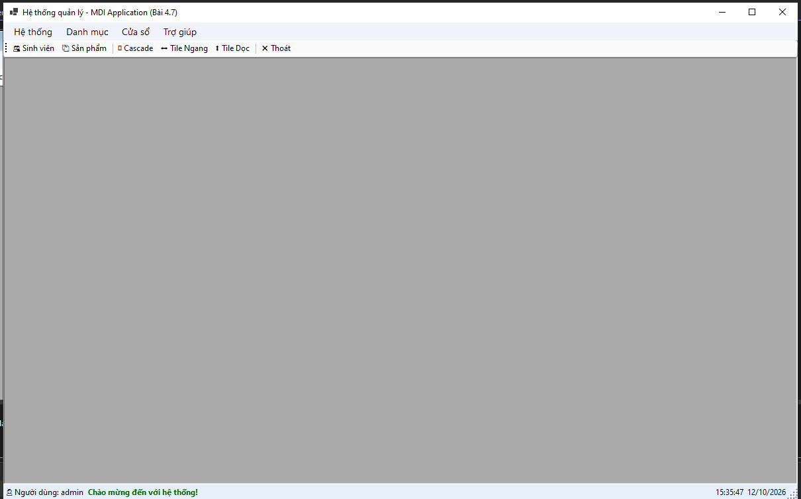
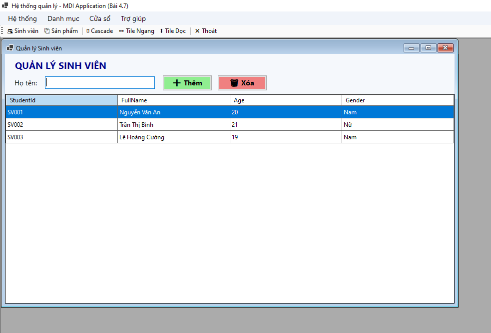
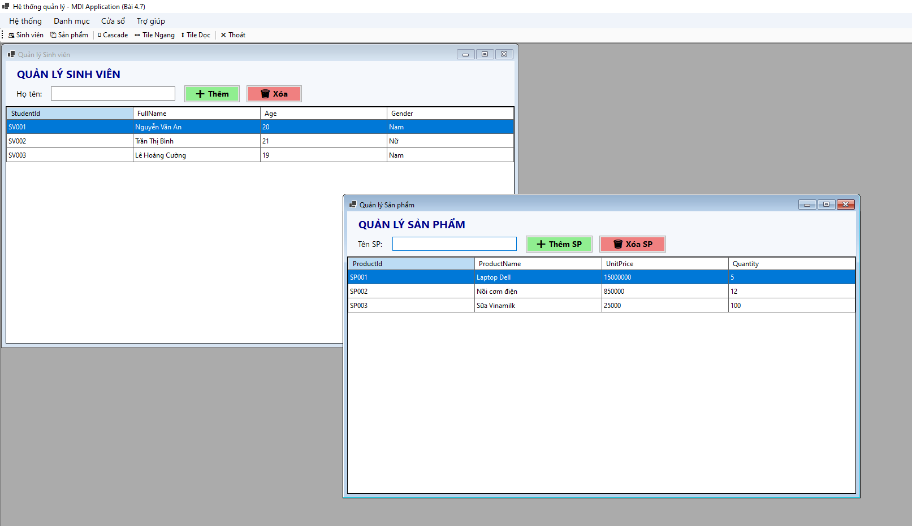
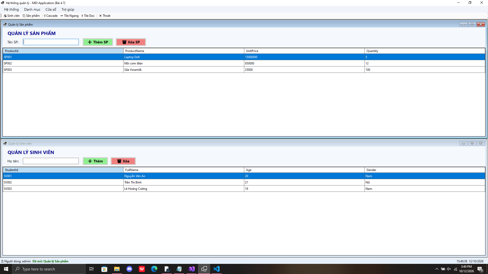
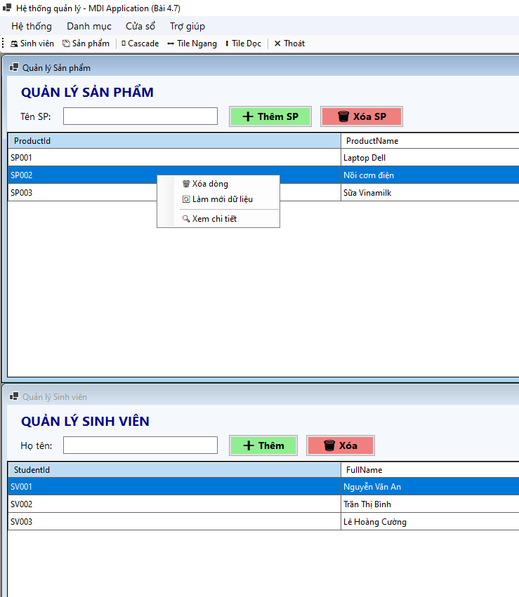
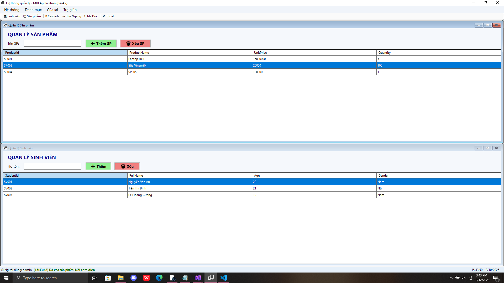
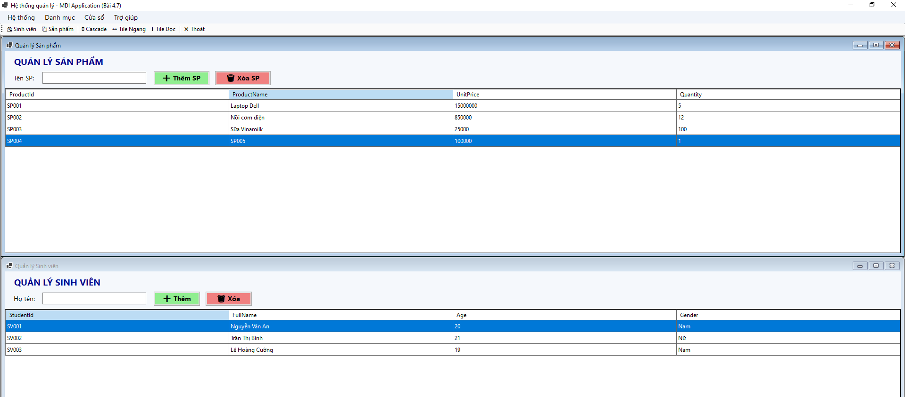

# BÁO CÁO BÀI TẬP

## THÔNG TIN SINH VIÊN
- **Họ và tên: Đặng Cao Thành Đạt**
- **Mã số sinh viên: 24810320215** 
- **Lớp: D19QTANM1** 
- **Tên môn học: Lập Trình.Net** 
- **Tên bài tập: BÀI 4.7: THIẾT KẾ KHUNG ỨNG DỤNG MDI & QUẢN LÝ ĐA CỬA SỔ** 

---

## KẾT QUẢ THỰC HÀNH

### 1. Ảnh màn hình Giao diện chính

### 2. MDI Child: Quản lý Sinh viên

### 2. Sắp xếp Cascade

### 2. Sắp xếp Tile Horizontal

### 2. ContextMenuStrip trên DataGridView

### 2. Parent-Child Communication

